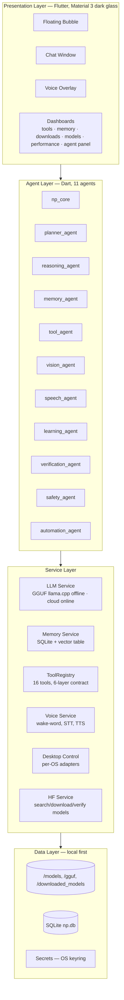
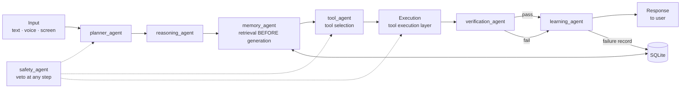
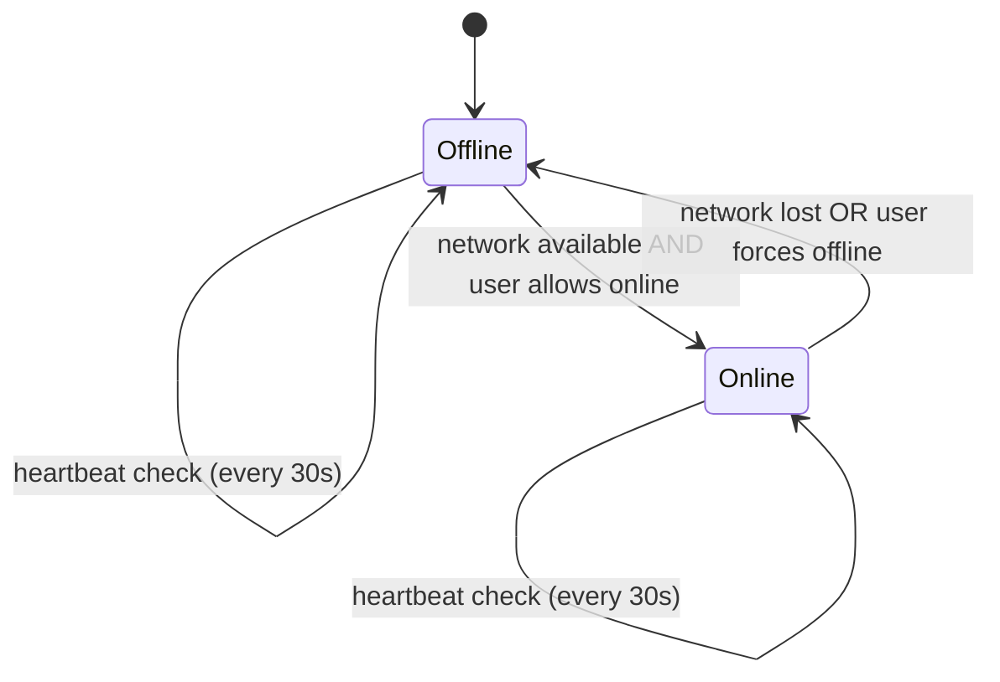

# NP — System Architecture

**Version:** 0.1 (design) · **Status:** Draft · **Last updated:** 2026-10-12

NP is a hybrid Offline+Online AI Operating System Agent. The Flutter frontend
runs on Windows, Linux, Android, and macOS. Core inference is offline via
GGUF models through llama.cpp; online services (cloud LLMs, web search, HuggingFace,
calendar/email APIs) engage only when available and permitted.

---

## 1. Design goals

| # | Goal | Rationale |
|---|------|-----------|
| 1 | Offline-first | The agent must do useful work with no network: chat, file ops, local RAG over notes, voice I/O, automation. |
| 2 | Single agent pipeline | One deterministic pipeline order; every agent has a defined input, output, and responsibility. No agent calls another directly — a shared `AgentContext` flows through the pipeline. |
| 3 | 4 GB RAM, CPU-only floor | Must run on a modest laptop with no GPU. Small quantized models (Q2_K–Q5_K), lazy weight loading, dynamic unload. |
| 4 | Verifiable behavior | Every tool execution passes a verification layer; every failure becomes a persisted failure record. |
| 5 | User owns their data | Memory lives in a local SQLite database. Online sync is opt-in per feature. Secrets never touch logs. |

## 2. Layered architecture



### 2.1 Component responsibilities

| Component | Responsibility |
|-----------|----------------|
| `np_core` | Pipeline orchestrator. Owns the `AgentContext`, routes between agents, applies mode (offline/online), streams tokens to UI. Never generates text itself. |
| `planner_agent` | Decomposes user intent into an ordered step list (`Plan`): steps, target tools, dependencies, stop conditions. Emits plans in both modes (smaller model offline → shorter plans). |
| `reasoning_agent` | Chain-of-thought / structured reasoning over the plan: selects the next step, builds tool arguments, decides when to ask the user vs. act. |
| `memory_agent` | Reads/writes the 7 memory layers. Retrieval runs **before** generation: short-term context window, long-term + semantic recall (cosine over embedding BLOBs), user profile, tool usage history, project state, skills. |
| `tool_agent` | Resolves tool names from the plan, validates input schemas, checks permission tier, dispatches to the execution layer, collects outputs. |
| `vision_agent` | Screenshot/screen-region capture, image understanding (local multimodal GGUF when present; online vision model when permitted), OCR. |
| `speech_agent` | Owns the full voice loop: wake-word ("Hey NP"), STT (whisper.cpp/vosk offline), TTS (Piper offline), barge-in, streaming audio. |
| `learning_agent` | Preference learning + mistake learning. Writes failure records on every failure; updates decision rules that planner/reasoning consult. |
| `verification_agent` | Validates tool outputs against the step's declared expectations (schema, exit codes, checksums, content assertions). Returns pass/fail + correction hints. |
| `safety_agent` | Permission enforcement, consent prompts, sandboxing, secret scrubbing, audit logging. Veto power: can halt any step before execution. |
| `automation_agent` | Desktop control (WinAPI / X11-Wayout / Cocoa / Android Accessibility): app launch, window management, input injection, clipboard, screenshots. |

## 3. The agent pipeline

Fixed order — no shortcuts, no reordering:



### 3.1 Pipeline stage contract

Each stage receives an immutable `AgentContext` and returns an updated copy:

```dart
class AgentContext {
  final String input;                 // raw user input (text or transcript)
  final InputKind inputKind;          // text | voice | screenEvent
  final Plan? plan;                   // planner output
  final ReasoningTrace reasoning;     // reasoning output
  final MemorySnapshot memory;        // retrieved memory (BEFORE generation)
  final List<ToolCall> toolCalls;     // selected + executed calls
  final VerificationReport? verification;
  final FailureRecord? failure;       // set when verification fails
  final String responseDraft;         // assembled before streaming
  final Mode mode;                    // offline | online
}
```

### 3.2 Stage-by-stage behavior

1. **Input** — Chat window, voice overlay, or OS events. Speech goes through
   `speech_agent` (STT → text) before entering the pipeline.
2. **Planner** — Produces `Plan(steps[], tools[], deps, stopConditions)`.
   Offline: capped at 5 steps (small-model planning degrades fast). Online: up to 12.
3. **Reasoning** — For the current step: `nextStep`, `toolName`, `args`,
   `needsUserInput?`. Uses retrieved memory as its context window.
4. **Memory Retrieval** — Queries all 7 layers (see `02-memory.md`). Semantic
   recall uses local embeddings + cosine similarity over the SQLite vector table.
   Retrieval always precedes generation; nothing is generated from a bare prompt.
5. **Tool Selection** — `tool_agent` matches `toolName` against the ToolRegistry,
   validates the input schema, and asks `safety_agent` for a permission decision.
6. **Execution** — The tool's execution layer runs (sandboxed where required).
   Sensitive ops pause for explicit user consent.
7. **Verification** — `verification_agent` checks the output: schema-valid?
   exit code 0? checksum match? semantic assertion (small-model judge) satisfied?
8. **Learning** — On pass: preference signals (e.g. "user accepted suggested plan").
   On fail: writes a `FailureRecord {task, result, cause, correction, preventionRule}`.
   Prevention rules feed back into planner/reasoning prompts and tool selection.
9. **Response** — `np_core` streams the response via token callbacks (offline) or
   SSE chunks (online). Includes citations of tools used when relevant.

`safety_agent` runs as a **cross-cutting veto**: it can halt at Planner (unsafe
plan), Tool Selection (permission denied), or Execution (consent withheld).

## 4. Offline / Online mode switching



### 4.1 Mode manager rules

- **Default:** Offline. NP never assumes network availability.
- **Online eligibility** requires BOTH: (a) reachable network (heartbeat to a
  configurable endpoint succeeds), and (b) the user has not enabled "Offline only"
  mode (a global toggle in Settings + a per-session override in the chat window).
- **Graceful degradation:** when a plan step requires an online-only tool
  (browser search, HF download, cloud LLM) and mode is Offline, `planner_agent`
  rewrites the plan to an offline alternative (e.g. local file/RAG search instead
  of web search) or marks the step `blocked_offline` and asks the user.
- **Mid-task switching:** if the network drops mid-plan, in-flight online calls
  are cancelled, their steps re-planned offline, and the user is notified once
  ("Went offline — continuing with local tools.").
- **Inference routing:** `LLMService.generate()` checks mode: Offline → llama.cpp
  GGUF; Online → cloud model *unless* the task is tagged `prefer_local`
  (privacy-sensitive tasks always stay local).

### 4.2 Capability matrix by mode

| Capability | Offline | Online |
|------------|---------|--------|
| Chat / Q&A | ✅ local GGUF | ✅ cloud or local |
| File, code, terminal, PDF, document tools | ✅ | ✅ |
| Local memory RAG | ✅ | ✅ |
| Voice STT/TTS (whisper.cpp, vosk, Piper) | ✅ | ✅ (or cloud voices) |
| Desktop automation | ✅ | ✅ |
| Web search / browsing | ❌ (or cached) | ✅ |
| HF model download | ❌ | ✅ |
| Cloud calendar/email sync | ❌ (local cache read-only) | ✅ |
| Model switching to cloud-only models | n/a | ✅ |

## 5. Key interfaces (Dart sketch)

```dart
// lib/core/agent.dart
abstract class Agent {
  String get name;
  Future<AgentContext> run(AgentContext ctx);
}

// lib/core/tool.dart  (full contract in 03-tools.md)
abstract class Tool {
  String get name;
  ToolDescription get description;   // 1. description layer
  JsonSchema get inputSchema;        // 2. input schema
  JsonSchema get outputSchema;       // 3. output schema
  PermissionTier get permission;     // 4. permission layer
  Future<ToolOutput> execute(ToolInput i, ExecutionCtx c); // 5. execution layer
  VerificationSpec get verification; // 6. verification layer
}

// lib/services/llm_service.dart
abstract class LlmService {
  Stream<String> generate(Prompt p);   // streaming token callbacks
  Future<void> loadModel(String path); // dynamic load
  Future<void> unloadModel();           // dynamic unload
}
```

## 6. Non-goals (v0.x)

- Multi-user / server deployment. NP is a single-user local agent.
- Training or fine-tuning models on-device (learning = rules + memory, not weights).
- Real-time collaboration features.
