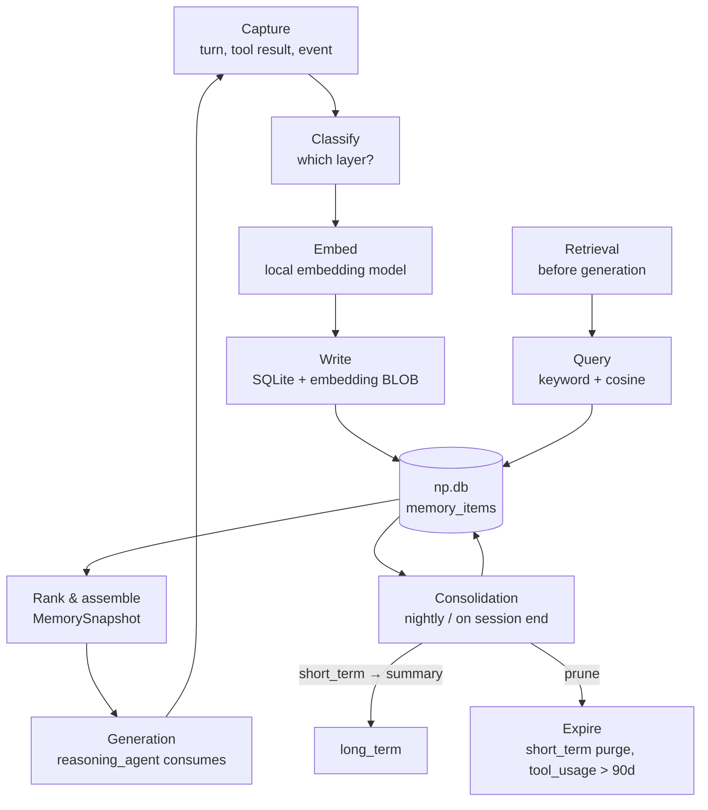
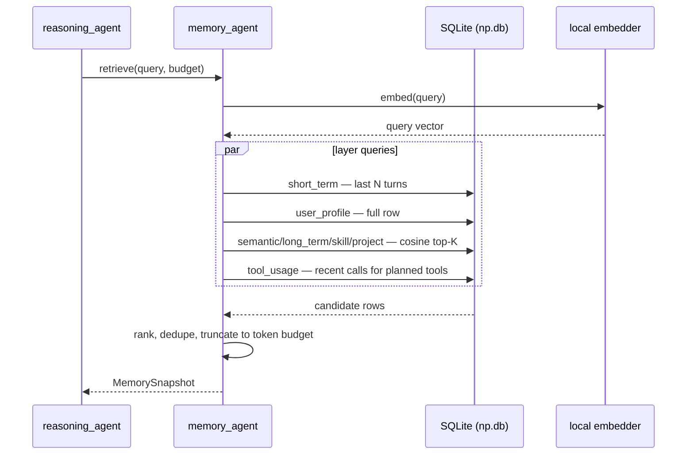

# NP — Memory System

**Version:** 0.1 (design) · **Status:** Draft · **Last updated:** 2026-10-12

All memory is local-first: a single SQLite database (`np.db`) with a vector
table storing embedding BLOBs. Retrieval happens **before generation** in the
agent pipeline — the `memory_agent` builds a `MemorySnapshot` that the
`reasoning_agent` and generation step consume as context.

---

## 1. The 7 memory layers

| # | Layer | What it holds | Retention | Example |
|---|-------|---------------|-----------|---------|
| 1 | `short_term` | Current conversation turns, active plan state, scratchpad | Session (purged or summarized on exit) | Last 20 messages of this chat |
| 2 | `long_term` | Consolidated facts and events from past sessions | Persistent | "User prefers dark mode; allergic to peanuts" |
| 3 | `semantic` | Embedded knowledge chunks: notes, docs, web clippings, RAG corpus | Persistent | Embedded paragraphs of the user's notes |
| 4 | `user_profile` | Structured profile: name, timezone, preferences, constraints | Persistent, user-editable | `{"name": "...", "tz": "Asia/Kathmandu"}` |
| 5 | `tool_usage` | History of tool calls: tool, args hash, success/fail, latency | Rolling 90 days | `file.read` failed on locked file → avoid retry pattern |
| 6 | `project` | Per-project working state: open tasks, file pointers, decisions | Per project, archived on close | Project "NP": docs written, next = voice module |
| 7 | `skill` | Reusable procedures learned or imported: how-to recipes | Persistent, versioned | "How to export PDF from this app: steps…" |

Layers 1–3 and 5–7 are stored as rows in `memory_items` (distinguished by a
`layer` column); `user_profile` has its own table for structured access.

## 2. Memory lifecycle



### 2.1 Lifecycle rules

- **Capture:** every user turn, assistant response, tool call result, and
  failure record is a candidate. The `memory_agent` classifies it into a layer
  (or discards trivia).
- **Embed:** semantic-bearing items (long_term, semantic, skill, project notes)
  get a local embedding vector at write time. Short-term turns are embedded
  lazily only if promoted.
- **Write:** single SQLite transaction; the embedding is stored as a BLOB
  alongside the item row.
- **Consolidation:** at session end (and nightly for long sessions),
  `learning_agent` summarizes `short_term` into `long_term` facts, deduplicates,
  and prunes expired rows.
- **Expiry:** `short_term` purged on session close (after summarization);
  `tool_usage` rows older than 90 days are deleted; other layers persist until
  the user deletes them.

## 3. Retrieval flow (before generation)



### 3.1 Retrieval algorithm

1. Embed the current query with the **local** embedding model (same model used
   at write time — vectors are only comparable within one model).
2. For vector layers (`long_term`, `semantic`, `skill`, `project`):
   compute cosine similarity between the query vector and each row's embedding
   BLOB; take top-K per layer (default K=5).
3. `short_term`: last N turns verbatim (default N=20), no vector search.
4. `user_profile`: always included in full (it's small and high-value).
5. `tool_usage`: last 20 calls for tools named in the current plan — lets the
   planner avoid recently-failed argument patterns.
6. Rank merged candidates by `(layerWeight × cosine)` then recency; truncate to
   the token budget (default 2,048 tokens); assemble `MemorySnapshot`.

### 3.2 Embedding strategy

- **Model:** a small local embedding model shipped with NP (e.g. a ~80 MB
  quantized `nomic-embed-text`-class GGUF run through the same llama.cpp
  binding as the LLM — no separate runtime). Runs on CPU; ~50–200 ms per
  short text on the 4 GB target.
- **Dimensions:** 768. Stored as float32 BLOB (3,072 bytes/row) — acceptable for
  tens of thousands of rows on local disk.
- **Cosine search:** implemented in Dart/SQLite, not a vector DB server:
  ```sql
  -- conceptual; actual loop runs in Dart over candidate BLOBs
  SELECT id, layer, content, embedding FROM memory_items
   WHERE layer IN ('long_term','semantic','skill','project');
  ```
  Dart decodes each BLOB to `Float32List`, computes cosine against the query
  vector, and keeps top-K with a bounded heap. For corpora > 50k rows, an
  optional IVF-style coarse partition (k-means over a sample, stored as
  `cluster_id`) narrows the scan — added only if profiling shows need.
- **Model pinning:** the embedding model name + version is stored in a
  `meta` table. If the model changes, `memory_agent` schedules a background
  re-embed of all vector rows (old rows are quarantined, not deleted, until
  re-embedding completes).

## 4. SQLite schema overview

```sql
-- Core item store: layers short_term, long_term, semantic, tool_usage, project, skill
CREATE TABLE memory_items (
  id          INTEGER PRIMARY KEY AUTOINCREMENT,
  layer       TEXT NOT NULL CHECK (layer IN
                ('short_term','long_term','semantic','tool_usage','project','skill')),
  key         TEXT,                 -- optional stable key (e.g. project id, skill name)
  content     TEXT NOT NULL,        -- the remembered text / JSON payload
  embedding   BLOB,                 -- float32 vector, NULL when not embedded
  source      TEXT,                 -- 'user' | 'agent' | 'tool:file' | ...
  created_at  INTEGER NOT NULL,     -- unix ms
  updated_at  INTEGER NOT NULL,
  expires_at  INTEGER,              -- NULL = persistent
  project_id  INTEGER REFERENCES projects(id)
);
CREATE INDEX idx_memory_layer ON memory_items(layer, updated_at DESC);
CREATE INDEX idx_memory_key   ON memory_items(layer, key);

-- Structured user profile (layer 4), one row, user-editable
CREATE TABLE user_profile (
  id          INTEGER PRIMARY KEY CHECK (id = 1),
  data        TEXT NOT NULL,        -- JSON: name, tz, prefs, constraints
  updated_at  INTEGER NOT NULL
);

-- Tool usage history (also surfaced as memory_items layer='tool_usage';
-- this table keeps the queryable structured form)
CREATE TABLE tool_usage (
  id          INTEGER PRIMARY KEY AUTOINCREMENT,
  tool        TEXT NOT NULL,
  args_hash   TEXT NOT NULL,        -- sha256 of canonicalized args (no secrets)
  success     INTEGER NOT NULL,     -- 0/1
  latency_ms  INTEGER,
  error       TEXT,                 -- scrubbed error message
  created_at  INTEGER NOT NULL
);
CREATE INDEX idx_tool_usage_tool ON tool_usage(tool, created_at DESC);

-- Projects (layer 6 backing store)
CREATE TABLE projects (
  id          INTEGER PRIMARY KEY AUTOINCREMENT,
  name        TEXT NOT NULL UNIQUE,
  status      TEXT NOT NULL DEFAULT 'active',  -- active | archived
  state       TEXT NOT NULL DEFAULT '{}',      -- JSON working state
  created_at  INTEGER NOT NULL,
  updated_at  INTEGER NOT NULL
);

-- Skills (layer 7 backing store), versioned
CREATE TABLE skills (
  id          INTEGER PRIMARY KEY AUTOINCREMENT,
  name        TEXT NOT NULL,
  version     INTEGER NOT NULL DEFAULT 1,
  recipe      TEXT NOT NULL,        -- the reusable procedure text
  embedding   BLOB,                 -- for semantic skill retrieval
  created_at  INTEGER NOT NULL,
  UNIQUE(name, version)
);

-- Failure records (written by learning_agent; see 08-learning.md)
CREATE TABLE failure_records (
  id            INTEGER PRIMARY KEY AUTOINCREMENT,
  task          TEXT NOT NULL,
  result        TEXT NOT NULL,
  cause         TEXT NOT NULL,
  correction    TEXT NOT NULL,
  prevention_rule TEXT NOT NULL,    -- consumed by planner/reasoning prompts
  tool          TEXT,
  created_at    INTEGER NOT NULL
);

-- Housekeeping
CREATE TABLE meta (
  key   TEXT PRIMARY KEY,
  value TEXT NOT NULL
);
-- meta keys: 'embedding_model', 'schema_version', 'created_at'
```

### 4.1 Notes on the schema

- `memory_items.content` for `tool_usage`-layer rows mirrors the structured
  `tool_usage` table in prose form ("`file.read` on locked path failed…") so
  vector search can find it; the structured table serves exact queries.
- `args_hash` is computed over canonicalized JSON **after secret scrubbing** —
  secrets never enter the database (see `07-security.md`).
- One SQLite file (`np.db`) per user profile directory; WAL mode enabled for
  concurrent reads during generation.

## 5. Token budgets (defaults, tunable in Settings)

| Layer | Budget |
|-------|--------|
| `short_term` | last 20 turns, ≤ 1,024 tokens |
| `user_profile` | full row, ≤ 256 tokens |
| `long_term` / `semantic` / `skill` / `project` | top-5 each by cosine, ≤ 1,536 tokens combined |
| `tool_usage` | last 20 relevant calls, ≤ 256 tokens |
| **Total MemorySnapshot cap** | **2,048 tokens** |
