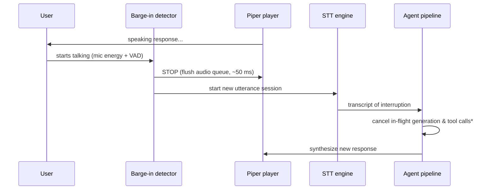

# NP — Voice Architecture

**Version:** 0.1 (design) · **Status:** Draft · **Last updated:** 2026-10-12

NP's voice loop is fully offline: wake-word detection, speech-to-text, and
text-to-speech all run on-device. The `speech_agent` owns the pipeline and
exposes streaming audio with barge-in (user can interrupt NP mid-speech).

---

## 1. Voice pipeline

```mermaid
flowchart LR
    MIC[Microphone<br/>16 kHz mono] --> WW[Wake-word detector<br/>"Hey NP"]
    WW -->|trigger| STT[STT engine<br/>whisper.cpp / vosk]
    STT -->|transcript| PIPE[Agent pipeline<br/>Input stage]
    PIPE -->|response text| TTS[TTS engine<br/>Piper]
    TTS --> SPK[Speaker]
    BARGE[Barge-in detector<br/>mic energy + VAD] -.->|interrupt| TTS
    BARGE -.->|cancel + listen| STT
```

### 1.1 Stage responsibilities

| Stage | Engine | Notes |
|-------|--------|-------|
| Wake-word | Lightweight keyword spotter (e.g. openWakeWord-style model, ~1–5 MB) | Always-on, ultra-low CPU; runs on a low-priority thread. Only the detector listens continuously — no audio is stored or transmitted. |
| STT | **whisper.cpp** (default; `tiny`/`base` GGUF) or **vosk** (smaller footprint option) | Selected in Settings. whisper.cpp shares the llama.cpp-style GGUF loading path; vosk used on the weakest devices. |
| TTS | **Piper** (onnx voices, ~60–120 MB per voice) | Streaming synthesis: audio chunks emitted as they're generated, not after the full sentence. |
| VAD | Lightweight voice activity detection (e.g. Silero VAD) | Drives end-of-utterance detection and barge-in. |

## 2. Wake-word detection pipeline

```
mic PCM (16 kHz, 16-bit) → ring buffer (2 s)
    → keyword spotter inference every 80 ms window
    → score > threshold (default 0.85, tunable)
    → trigger: play earcon, open STT session, show voice overlay
```

- **False-trigger control:** threshold + a 1.5 s cooldown after each trigger;
  the overlay shows "Listening…" so the user sees every activation.
- **Privacy:** the wake-word thread processes audio in-memory only. Audio is
  buffered for STT **only after** a trigger; the pre-trigger ring buffer is
  never written to disk.
- **"Hey NP"** is the fixed default phrase; custom phrases are a post-v1.0
  feature (requires retraining the spotter).

## 3. STT: whisper.cpp / vosk

| | whisper.cpp (default) | vosk (light) |
|---|---|---|
| Model | `ggml-tiny.en` (~75 MB) / `ggml-base.en` (~145 MB) | small-en-us (~40 MB) |
| Latency (4 GB CPU) | ~0.4–1.0 s for a 5 s utterance (tiny) | ~real-time, lower accuracy |
| Streaming | Partial hypotheses via segment callbacks | Word-level partials |
| Languages | Multilingual (tiny/base) | Per-language small models |

- STT runs in its own isolate; partial transcripts stream to the voice overlay
  as "hearing…" text.
- **End of utterance:** VAD silence ≥ 700 ms → finalize → transcript enters the
  agent pipeline as `InputKind.voice`.
- Model files live in the same discovery dirs (`/models`, `/gguf`,
  `/downloaded_models`) and are registered in the `models` table with
  `family='stt'`.

## 4. TTS: Piper

- Voice files: Piper onnx + JSON config, downloaded once (shipped default:
  one compact English voice, ~65 MB).
- **Streaming:** Piper generates audio per sentence/clause; each chunk is
  queued to the audio player immediately — first audio starts well before the
  full response text is generated. The LLM token stream feeds the TTS
  sentence splitter directly.
- Voice selection, rate, and volume in Settings; per-voice files in
  `/models/voices`.

## 5. Barge-in / interruption handling

The user can interrupt NP while it's speaking ("barge-in"):



- **Detection:** mic energy above threshold + VAD speech flag for ≥ 250 ms
  *while TTS is playing* → barge-in. Echo cancellation (AEC) is attempted via
  platform APIs; where unavailable, a short 300 ms "grace period" after TTS
  start ignores mic input to avoid self-triggering.
- **Cancellation semantics:** in-flight LLM generation is cancelled (isolate
  flag); in-flight **tool executions are NOT force-killed** — they run to a
  safe checkpoint, then their results are discarded (killing a `file.write`
  mid-flush risks corruption). The pipeline restarts from the Planner with the
  new input.
- The voice overlay shows "Interrupted — listening…" so the state is visible.

## 6. Streaming audio design

- Audio path: mic → `speech_agent` → STT isolate; TTS → platform audio player.
  All PCM stays in-memory; no audio files are persisted unless the user
  explicitly saves a transcript/clip.
- Backpressure: the TTS chunk queue is bounded (8 chunks); if the LLM
  outruns the speaker, generation continues but TTS chunks beyond the bound
  are coalesced (never dropped mid-sentence — coalescing happens at sentence
  boundaries).
- Sample formats: 16 kHz mono for STT input; Piper output (typically 22.05 kHz)
  resampled by the platform player.

## 7. Latency budget (offline, 4 GB CPU target)

| Segment | Budget | Notes |
|---------|--------|-------|
| Wake-word trigger → earcon | ≤ 300 ms | Spotter runs continuously |
| End-of-utterance → final transcript | ≤ 1.2 s | whisper.cpp tiny |
| Transcript → first LLM token | ≤ 800 ms | Model warm (already loaded) |
| First token → first TTS audio | ≤ 1.5 s | Sentence splitter needs ~1 sentence |
| **Total: user stops talking → NP starts speaking** | **≤ ~3.5 s** | |
| Barge-in: voice detected → TTS stopped | ≤ 150 ms | Feels instant |

If the LLM is cold (unloaded), add model load time (~5–15 s for 3B Q4_K_M via
mmap) — the overlay shows "Warming up…" and the idle-unload policy (§4 of
`04-offline-llm.md`) keeps the model resident during voice sessions.

## 8. Modes & fallbacks

- **Offline:** everything above. This is the primary design.
- **Online (optional):** user may opt into cloud STT/TTS voices in Settings;
  requires explicit consent per session ("Use cloud voice?") and the same
  privacy rule: no audio leaves the device without consent.
- **No-mic environments:** voice overlay degrades to a "type instead" prompt;
  the pipeline is input-kind agnostic.

## 9. Privacy rules

1. No audio is recorded, stored, or transmitted except: (a) the post-trigger
   utterance buffer, held in RAM only for STT; (b) explicit user-saved clips.
2. Transcripts are treated as conversation text — they enter `short_term`
   memory like typed input.
3. Cloud voice features are off by default and gated by per-session consent.
