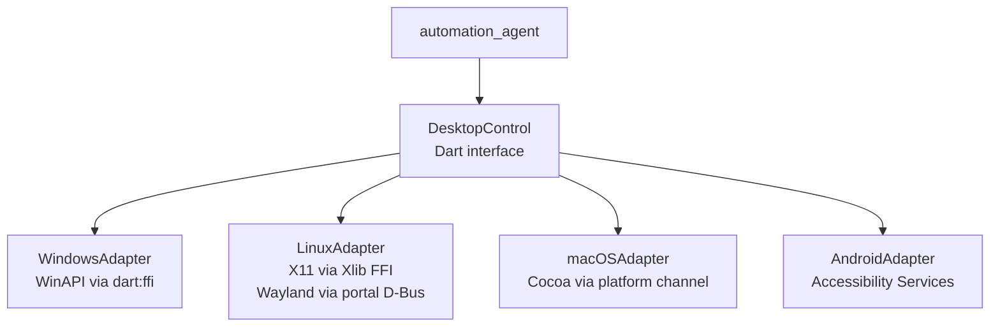

# NP — Desktop Control (per-OS)

**Version:** 0.1 (design) · **Status:** Draft · **Last updated:** 2026-10-12

The `automation_agent` drives the host OS through per-OS adapter services.
Flutter/Dart calls a `DesktopControl` interface; each OS has an adapter that
implements it with native APIs (via `dart:ffi` or platform channels).

---

## 1. Adapter architecture



```dart
abstract class DesktopControl {
  Future<List<AppWindow>> listWindows();
  Future<void> launchApp(String target);          // path / bundle id / package
  Future<void> focusWindow(String windowId);
  Future<void> closeWindow(String windowId);
  Future<void> minimizeWindow(String windowId);
  Future<String> screenshot({Rect? region});     // returns PNG path
  Future<void> moveMouse(int x, int y);
  Future<void> click(int x, int y, {MouseButton button = left});
  Future<void> pressKey(String key);              // 'Enter', 'ctrl+c', ...
  Future<void> typeText(String text);
  Future<String> getClipboard();
  Future<void> setClipboard(String text);
}
```

Every method routes through the `automation` tool's permission layer
(Confirm for launch/focus/screenshot; Sensitive for input injection and
clipboard write — see `03-tools.md` and `07-security.md`).

## 2. Per-OS implementation notes

### 2.1 Windows — WinAPI (`user32.dll`, via dart:ffi)

- Windows enumerated with `EnumWindows`; titles via `GetWindowTextW`.
- Launch: `ShellExecuteW` / `CreateProcessW`.
- Focus: `SetForegroundWindow` (+ `AttachThreadInput` workaround for focus steal rules).
- Input: `SendInput` for mouse/keyboard; `keybd_event` avoided (legacy).
- Screenshot: `BitBlt` from the desktop DC, or the Windows Graphics Capture API
  for per-window capture.
- Clipboard: `OpenClipboard` / `GetClipboardData(CF_UNICODETEXT)`.

### 2.2 Linux — X11 and Wayland

| Capability | X11 (Xlib via FFI) | Wayland |
|------------|-------------------|---------|
| List/focus/close windows | `_NET_CLIENT_LIST`, `XRaiseWindow`, `WM_DELETE_WINDOW` | **Limited** — no global window list; use `xdg-activation` + compositor-specific APIs |
| Input injection | `XTestFakeKeyEvent` / `XTestFakeButtonEvent` (XTest) | Via `libei` / RemoteDesktop portal (`org.freedesktop.portal.RemoteDesktop`) — **requires user consent dialog** |
| Screenshot | `XGetImage` on root window | ScreenCast portal — **requires consent dialog** |
| Launch apps | `GAppInfo` / `xdg-open` via process spawn | Same as X11 |
| Clipboard | X selections (`CLIPBOARD`) | DataControl / compositor clipboard |

**Design decision:** on Wayland, NP uses Freedesktop portals exclusively.
Consent dialogs are a feature, not a bug — they satisfy the Sensitive tier.
Where a portal is unavailable, the capability is reported `unsupported_wayland`
and the planner falls back (e.g. keyboard shortcuts the user presses manually,
with on-screen guidance).

### 2.3 macOS — Cocoa (platform channel → Swift)

- Window listing: `CGWindowListCopyWindowInfo`.
- Launch/focus: `NSWorkspace.launchApplication` / `activateFileViewerSelecting`.
- Input: `CGEventCreateKeyboardEvent` / `CGEventCreateMouseEvent` posted via
  `CGEventPost` — **requires Accessibility permission** (System Settings →
  Privacy & Security); NP detects the grant and guides the user to enable it.
- Screenshot: `CGWindowListCreateImage` / ScreenCaptureKit.
- Clipboard: `NSPasteboard`.

### 2.4 Android — Accessibility Services

- NP ships an `AccessibilityService` (Kotlin) declared in the manifest.
- Capabilities via `AccessibilityNodeInfo`: traverse UI tree, `performAction`
  (click, scroll, set text), global actions (back, home, recents).
- Launch apps: `startActivity` with package intents.
- Screenshots: `takeScreenshot` API (API 30+) or MediaProjection with consent.
- Input injection outside the accessibility tree is **not** available —
  automation is node-based, not coordinate-based, on Android.
- The service must be explicitly enabled by the user in system Settings;
  NP deep-links to the settings page on first use.

## 3. Capability matrix

| Capability | Windows (WinAPI) | Linux X11 | Linux Wayland | macOS (Cocoa) | Android (A11y) |
|------------|:---:|:---:|:---:|:---:|:---:|
| Open apps | ✅ | ✅ | ✅ | ✅ | ✅ |
| Close apps / windows | ✅ | ✅ | ⚠️ partial¹ | ✅ | ✅ (global back / force-stop w/ consent) |
| List windows | ✅ | ✅ | ❌ | ✅ | ✅ (node tree) |
| Focus window | ✅ | ✅ | ⚠️ partial¹ | ✅ | n/a (activity-based) |
| Screenshots (full/region) | ✅ | ✅ | ✅² | ✅ | ✅² |
| Clipboard read/write | ✅ | ✅ | ✅ | ✅ | ✅ |
| Window management (move/resize/minimize) | ✅ | ✅ | ❌ | ✅ | n/a |
| Input injection (mouse/keyboard) | ✅ | ✅ | ✅² | ✅³ | ⚠️ node actions only |
| Global hotkeys (e.g. summon bubble) | ✅ | ✅ | ⚠️ compositor-dependent | ✅ | ✅ |

¹ Wayland: no global window control by design; focus/close via app-specific
activation tokens where the compositor supports it.
² Requires the OS consent dialog (portal / MediaProjection) — maps to the
Sensitive permission tier.
³ macOS input injection requires the Accessibility permission grant.

## 4. Safety rules for desktop control

1. **Coordinate grounding:** `click(x, y)` is only issued with coordinates from
   a fresh screenshot + `vision_agent` grounding — never from the LLM's
   imagination. Stale screenshots (> 5 s) are re-captured before clicking.
2. **Destructive actions** (close without save, force-stop, clipboard overwrite
   of large content) require Sensitive-tier consent with the target named.
3. **Rate limits:** max 10 input actions per plan step; plans that need more
   must checkpoint and re-verify screen state between batches.
4. **Android:** no silent background input — every automation run shows the
   floating bubble indicator while active.
5. **Audit:** every desktop action is audit-logged with target + timestamp
   (see `07-security.md`).
