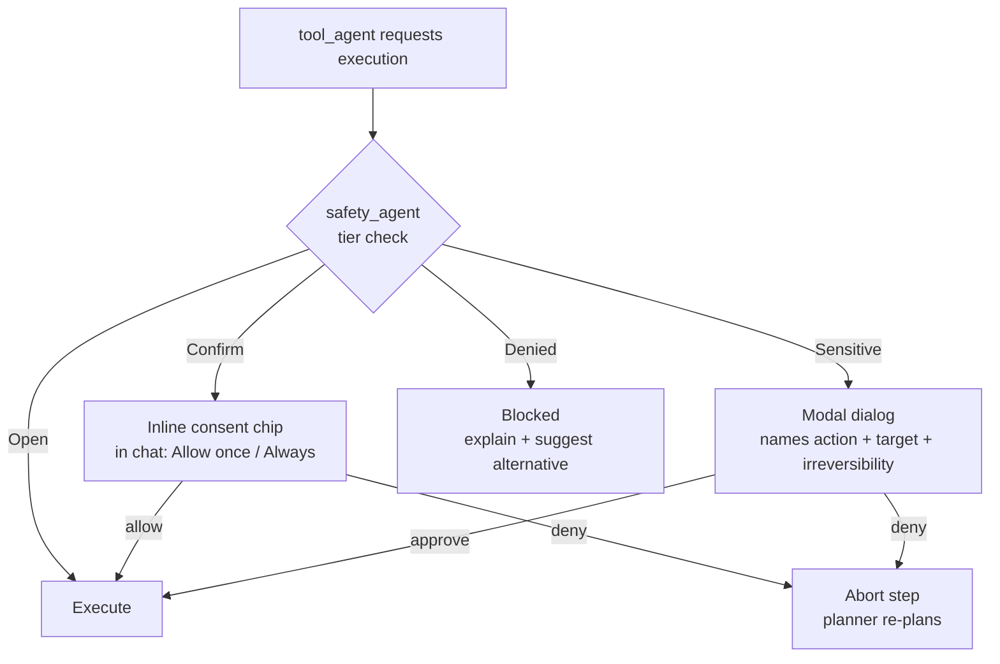

# NP — Security Model

**Version:** 0.1 (design) · **Status:** Draft · **Last updated:** 2026-10-12

NP runs arbitrary tools on the user's machine and speaks for the user online.
The security model is built on four pillars: permission tiers, explicit
consent UX, sandboxing, and secret hygiene — all enforced by `safety_agent`
with veto power over the pipeline.

---

## 1. Permission tiers

| Tier | Meaning | UX | Examples |
|------|---------|----|----------|
| **Open** | Harmless, reversible, local | No prompt; logged | `file.list`, `task.create`, `pdf.extract`, `memory.recall`, `calendar.list` |
| **Confirm** | Noteworthy: writes, costs, or external effects | One-tap inline consent ("Allow once / Always for this tool") | `file.write`, `code.run`, `terminal.*`, `email.draft`, `automation.launch`, `image.generate` |
| **Sensitive** | Destructive, privacy-relevant, or credential-adjacent | Explicit approval dialog naming the exact action + target; always audit-logged | `file.delete`, `email.send`, `automation.type/click`, clipboard write, `database` writes, cloud sends |
| **Denied** | Never allowed | Blocked with explanation | Exfiltrating secrets, disabling safety_agent, nested tool execution |

### 1.1 Tier resolution

1. Each tool declares a **base tier** (see `03-tools.md`); individual ops can
   escalate (e.g. `file` read = Open, `file` delete = Sensitive).
2. `safety_agent` evaluates: `tier(tool, op, args, mode, history)`.
   History matters: the 50th identical Confirm in a session can be
   "always allow"-ed by the user; Sensitive can never be auto-approved.
3. **Offline mode** can only *lower* effective risk for network ops (they
   become `blocked_offline`); it never lowers tiers for local destructive ops.

## 2. Consent UX



Consent rules:

- Dialogs **name the concrete target**: "Delete `/home/user/old_notes/` (42 files)?"
  — never "Allow file.delete?".
- "Always allow" is per (tool, op-pattern), stored in `user_profile`, revocable
  in Settings → Permissions. Sensitive tier has no "always allow".
- Consent expires: approvals are per-plan-run; a new plan re-asks (except
  "always allow" entries).
- Voice mode: Confirm-tier ops are spoken back ("Should I delete old_notes?")
  and require an affirmative utterance; Sensitive-tier ops **cannot** be
  approved by voice alone — the modal must be tapped (prevents accidental or
  overheard approvals).

## 3. Sandboxing strategy

| Surface | Sandbox |
|---------|---------|
| `code.run`, `terminal.*` | Subprocess with CPU/memory caps, 120 s timeout, restricted env (no inherited secrets), denylist of destructive patterns (`rm -rf /`, `:(){:|:&};:`, etc.), optional network block (default ON; Sensitive approval to lift) |
| `file.*` | Allowed-roots jail (`~/`, project dirs, explicit grants); symlink resolution — a symlink escaping the jail is denied; 10 MB read cap |
| `browser` | Headless Chromium, fresh profile per domain group, no access to user's main browser profile; downloads quarantined to `~/Downloads/np-quarantine/` until user approves |
| `database` | Parameterized statements only; per-op allowlist (SELECT vs. writes); external DB files need Confirm-tier grant per path |
| LLM/tool boundary | **No tool calls tools.** Tool outputs are data, never instructions — prompt-injection content in tool output is flagged by `verification_agent` heuristics (e.g. "ignore previous instructions" patterns) and surfaced to the user, not obeyed |
| Automation | Coordinate grounding from fresh screenshots only (see `06-desktop-control.md`); max 10 input actions per step |

## 4. Secrets handling

**Rule: secrets never enter logs, memory, prompts, or tool outputs.**

1. **Storage:** API keys, OAuth tokens, and credentials live in the **OS
   keyring** (Windows Credential Manager / macOS Keychain / Linux
   Secret Service / Android Keystore) — never in `np.db`, never in files.
2. **Scrubbing points:**
   - Before `tool_usage` logging: args are canonicalized and secret-shaped
     values (keys, tokens, passwords, emails in auth contexts) are replaced
     with `⟨redacted⟩` *before* hashing.
   - Before prompt construction: `memory_agent` strips anything matching
     secret patterns from retrieved context.
   - Tool outputs pass through the scrubber before reaching the LLM.
3. **No echo:** the LLM system prompt forbids repeating credential values;
   `verification_agent` rejects responses containing keyring-sourced values.
4. **Audit log** records *that* a secret was accessed (tool + timestamp),
   never the value.

## 5. Audit log

Append-only SQLite table, viewable in the dashboards:

```sql
CREATE TABLE audit_log (
  id         INTEGER PRIMARY KEY AUTOINCREMENT,
  ts         INTEGER NOT NULL,
  actor      TEXT NOT NULL,   -- 'user' | 'agent:tool_agent' | ...
  action     TEXT NOT NULL,   -- 'tool.execute', 'consent.grant', 'model.switch', ...
  target     TEXT,            -- scrubbed target description
  tier       TEXT,            -- open | confirm | sensitive | denied
  decision   TEXT NOT NULL,   -- 'allow' | 'deny' | 'block'
  detail     TEXT             -- scrubbed
);
CREATE INDEX idx_audit_ts ON audit_log(ts DESC);
```

- Retained 180 days, then pruned (configurable).
- Exportable (JSON) for user review.

## 6. Threat model (v0.x scope)

| Threat | Mitigation |
|--------|------------|
| Malicious web content → prompt injection via `browser`/`research` | Tool outputs treated as data; injection-pattern heuristics + user surfacing; Sensitive ops still need explicit consent |
| Runaway automation damaging the desktop | Coordinate grounding, 10-action cap, Sensitive consent for injection, audit trail |
| Credential theft via logs/memory | Keyring storage, 3-point scrubbing, no-echo rule |
| Malicious GGUF model | sha256 verification on HF download (see `09-huggingface.md`); models only load from discovery dirs, never from arbitrary downloads |
| Network attacker (online mode) | TLS everywhere; heartbeat endpoint pinned; offline-first means most work never touches the network |
| Physical device access | Out of scope for v0.x (relies on OS disk encryption + lock screen); noted as future work |

## 7. Safety_agent veto protocol

`safety_agent` is consulted at three pipeline gates (Planner output, Tool
Selection, pre-Execution). A veto returns
`{verdict: deny|block, reason, saferAlternative?}`; `np_core` then either
re-plans (deny) or aborts with explanation (block). The veto and its reason
are audit-logged. `safety_agent` itself cannot be disabled, reconfigured, or
re-prompted by any other agent or tool output.
