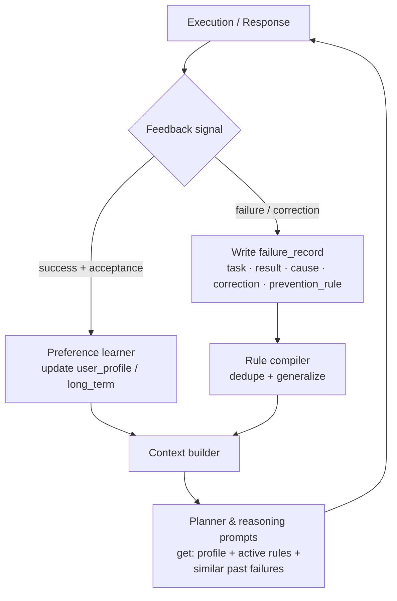

# NP — Learning Framework

**Version:** 0.1 (design) · **Status:** Draft · **Last updated:** 2026-10-12

NP learns without training weights. The `learning_agent` maintains two
learning channels — **preference learning** (what the user likes) and
**mistake learning** (what went wrong) — persisted in SQLite and consulted by
the planner and reasoning agents on every run.

> Scope note: on-device fine-tuning is explicitly out of scope for v0.x.
> "Learning" = better memory, better rules, better prompts — not gradient
> updates.

---

## 1. The two channels

### 1.1 Preference learning

Signals that capture user taste, captured implicitly and explicitly:

| Signal | Source | Example |
|--------|--------|---------|
| Accepted suggestion | User says yes / taps accept | "User accepted the shorter plan variant" |
| Rewording | User rewrites NP's draft | Email drafts trend shorter over time → default to concise |
| Explicit "remember" | "Remember that I prefer…" | Stored to `user_profile` / `long_term` |
| Tool choice corrections | User picks tool B after NP used tool A | Prefer `pdf` over `document` for text extraction |
| Dismissals | User cancels/ignores a dashboard nudge | Stop suggesting that nudge |

Preferences are stored as `long_term` memory items and summarized into
`user_profile` (e.g. `{"style": "concise", "email_tone": "formal"}`).
The reasoning prompt includes the profile, so preferences shape generation
without any model change.

### 1.2 Mistake learning

**Every failure produces a failure record.** A failure = verification failed,
tool errored, user corrected NP, or the user explicitly said "that was wrong".

Failure record format (`failure_records` table, see `02-memory.md`):

```json
{
  "task": "Delete all .tmp files in ~/Downloads",
  "result": "file.delete removed ~/Downloads/tmp_backup/ (a directory), user lost archived logs",
  "cause": "Glob '~/*.tmp' matched a directory name; tool deleted recursively without checking file-vs-dir",
  "correction": "Restored from trash; re-ran with file-vs-dir check, deleted only regular files",
  "prevention_rule": "RULE: before file.delete with a glob, list matches and require the user to confirm the expanded list when any match is a directory.",
  "tool": "file",
  "created_at": 1728
}
```

### 1.2.1 Worked example

> **Task:** "Summarize the Q3 report and email it to Priya."
>
> **Result:** NP summarized `Q3_report_draft.pdf` (an outdated draft) instead
> of `Q3_report_final.pdf`, and emailed the wrong summary.
>
> **Cause:** Two similarly-named files; planner picked the first `file.list`
> hit without disambiguation.
>
> **Correction:** Recalled the email (where supported) / sent a correction;
> re-summarized the final file.
>
> **Prevention rule:** "RULE: when multiple files match a user reference
> (draft vs final, v1 vs v2), list the candidates and ask the user to pick
> before acting — never guess."

## 2. Feedback loop



### 2.1 How rules change future behavior

1. **Prompt injection (the mechanism):** at the start of each pipeline run,
   `memory_agent` retrieves: the user profile, the top-K prevention rules
   relevant to the planned tools (cosine match on rule text vs. task), and any
   failure records for the same tool in the last 30 days. These are prepended
   to the planner and reasoning prompts under a "Lessons learned" section.
2. **Rule compiler:** when a new failure record arrives, `learning_agent`
   checks it against existing rules (cosine similarity > 0.85 → merge/dedupe
   instead of adding). Rules are versioned; the user can view, edit, or delete
   them in the dashboards (memory dashboard → "Rules" tab).
3. **Tool selection bias:** `tool_usage` + failure records feed a per-tool
   reliability score. If `file.delete` with globs failed twice recently, the
   planner is nudged (via prompt, not hard logic) to prefer `file.list` +
   explicit paths first.
4. **Escalation:** a rule violated 3+ times becomes a **hard guard**: the
   planner must include the guard's required step (e.g. "list glob matches")
   or `verification_agent` fails the plan.

### 2.2 Rule lifecycle

```
proposed (from failure) → active → [violated 3× → hard guard]
                       → edited by user → active (v+1)
                       → deleted by user → gone (failures that spawned it stay)
```

Rules never auto-delete; stale rules are the user's to prune (prevents the
agent silently forgetting safety lessons).

## 3. Consolidation & forgetting

- **Session-end consolidation:** `short_term` turns are summarized into
  `long_term` facts ("User is preparing a Dashain presentation") and
  candidate preferences are proposed (not auto-applied — the user confirms in
  the dashboard, avoiding mis-learned taste).
- **Forgetting:** the `memory.forget` tool (Sensitive tier) deletes items by
  key/query; deleting a failure record does not delete its compiled rule
  (rules are independently managed).
- **No cross-user learning:** single-user system; nothing leaves the device.

## 4. Metrics (performance dashboard)

| Metric | Definition |
|--------|------------|
| Failure rate per tool | failures / executions, 7-day rolling |
| Repeat-failure rate | failures whose cause matches an existing rule — should trend to 0 |
| Rule count / hard guards | growth and escalation over time |
| Preference adoption | % of suggestions accepted (planning quality proxy) |

These are displayed in the performance dashboard and guide tuning of prompts
and the rule compiler — the observable loop that proves learning works.
